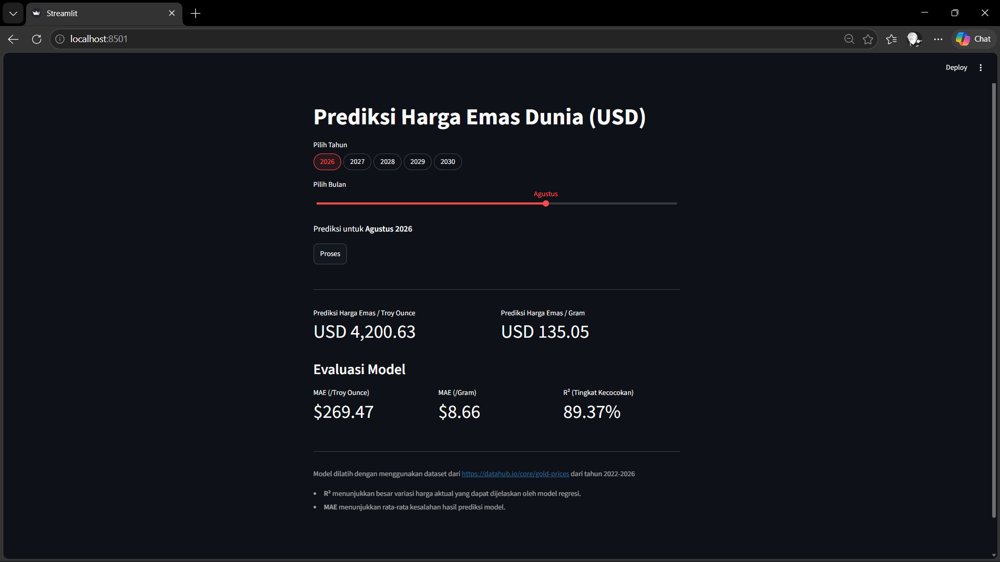

# Global Gold Price Prediction

A Streamlit application for predicting global gold prices in USD using a
**Linear Regression** model. Users can select a prediction year and month, then
view the estimated price per troy ounce and per gram.

## Preview



## Features

- Select a prediction year from 2026–2030.
- Select a prediction month using a slider.
- Display the predicted gold price in USD per troy ounce.
- Convert the predicted price to USD per gram.
- Display model evaluation using MAE and R².

## Technologies

- Python
- Streamlit
- NumPy
- scikit-learn
- Joblib

## Struktur Proyek

```text
week4/
├── app.py
├── linear_regression_emas.pkl
├── Linear_Regression_Prediksi_Emas.ipynb
├── requirement.txt
└── assets/
    └── image.png
```

## Installation

Create and activate a virtual environment,

```bash
python -m venv .venv
```

activate,

Windows:

```bash
.venv\Scripts\activate
```

macOS/Linux:

```bash
source .venv/bin/activate
```

then install the dependencies.

```bash
python -m pip install -r requirement.txt
```

## Running the Application

Run the following command to run the app locally:

```bash
streamlit run app.py
```

Select a year and month, then click **Process** to display the prediction.

## Model and Evaluation

The model is stored in `linear_regression_emas.pkl` and predicts prices based on
the time period. It was trained using gold-price data from [Datahub Gold
Prices](https://datahub.io/core/gold-prices) for the 2022–2026 period.

The evaluation metrics displayed by the application are:

- **MAE:** USD 269.47 per troy ounce.
- **MAE:** approximately USD 8.66 per gram.
- **R²:** 89.37%.

These values represent the model evaluation results from the data used during
application development.
